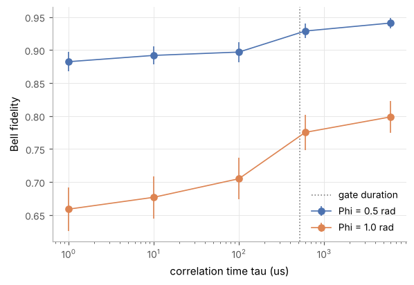

# Two-ion CNOT gates: Cirac-Zoller error budget and Mølmer-Sørensen robustness

Simulation of the Cirac-Zoller CNOT of Schmidt-Kaler et al. (Nature 422, 408, 2003) from its laser pulse sequence, an error budget against the published measurements, time-correlated laser noise, and a comparison with the Mølmer-Sørensen gate, including a reproduction of Sørensen and Mølmer (PRL 82, 1971, 1999).



## Key results

| | Result |
|---|---|
| Ideal sequence | CNOT in populations; full operator -CY (process fidelity 1.0 with CY, 0.25 with a plain CNOT) |
| Error budget | Laser phase noise dominates: 0.3 rad costs 22% of Bell fidelity, addressing 5% costs 2% |
| Against experiment | All errors: truth table 0.784 (measured 0.70-0.80), Bell fidelity 0.734 (measured 0.71) |
| Correlated noise | At equal accumulated phase (1 rad), slow drift keeps 0.80 Bell fidelity against 0.66 for fast noise |
| Warm bus | Cirac-Zoller falls to 0.33 with 2 phonons; Mølmer-Sørensen keeps 0.99 at mean 0.5 phonon (CZ 0.91) |
| MS paper, full Hamiltonian | Transfer gg → ee at νt = 6060 (Eq. 3: 6283), ≥ 96% for Fock states n = 0-5, 95% with heating, echo recovers coherence 0.485 vs 0.02 |
| Qiskit | A depolarizing model matches the fidelity but not the error structure (SS 0.41 / DD 0.41 vs 0.37 / 0.46 physical, 0.42 / 0.45 measured) |

## Model

Two ions (qubit |S⟩ = 0, |D⟩ = 1) and the shared vibrational mode, truncated at 8 phonons (`cirac_zoller.py`).

| Element | Implementation |
|---|---|
| Pulses | Carrier and blue-sideband rotations, sequence of Table 1 of Schmidt-Kaler et al. |
| Errors | Thermal bus population, addressing crosstalk, intensity (Rabi angle) noise, laser phase noise per pulse |
| Correlated noise | Laser frequency as an Ornstein-Uhlenbeck process, phase integrated over the 517 µs gate |
| Mølmer-Sørensen, first order | Bichromatic Hamiltonian in the Lamb-Dicke limit, 300 time steps |
| Mølmer-Sørensen, paper | Full Hamiltonian e^{iη(a+a†)} in QuTiP, δ = 0.9ν, Ω = 0.1ν (0.05ν for the echo), η = 0.1, 16 phonon levels |
| Heating | Quantum trajectories with c₁ = √(Γ(1+n̄)) a, c₂ = √(Γ n̄) a†, Γ = 2·10⁻⁴ν, n̄ = 2, 20 trajectories |

Random errors use fixed seeds, so every number below is reproducible.

## Results

### Error budget (`02`)

| Error source | Truth table | Bell fidelity |
|---|---|---|
| Ideal | 1.000 | 1.000 |
| Thermal bus, 2% in n = 1 | 0.999 | 0.999 |
| Addressing, 5% | 0.981 | 0.979 |
| Intensity, 3% | 0.991 | 0.992 |
| Phase noise, 0.3 rad | 0.804 | 0.775 |
| All, phase noise 0.32 rad | 0.784 | 0.734 |

The 0.32 rad phase noise was tuned to the measured Bell fidelity: a fit, not a prediction.

### Correlated phase noise (`03`), Bell fidelity

| Correlation time τ (µs) | 1 | 10 | 100 | 600 | 6000 |
|---|---|---|---|---|---|
| Accumulated phase 0.5 rad | 0.882 | 0.892 | 0.897 | 0.929 | 0.941 |
| Accumulated phase 1.0 rad | 0.659 | 0.677 | 0.705 | 0.775 | 0.799 |

### Bus temperature (`04`)

| Bus state | Cirac-Zoller Bell fidelity |
|---|---|
| n = 0 / 1 / 2 / 3 | 1.000 / 0.952 / 0.331 / 0.321 |
| Thermal, mean 0.5 phonon | CZ 0.914, Mølmer-Sørensen 0.993 |

### Sørensen and Mølmer 1999 reproduced (`06`)

| Figure | Paper | Simulation |
|---|---|---|
| Fig. 2, coherent motion n̄ = 2 | Full transfer, Re ρ_gg,ee < 0.03 | Transfer at νt = 6060 (96%), Re ρ_gg,ee ≤ 0.023 |
| Eq. 3 / footnote 10 | π/Ω̃ = 6283 / 5969 | 6060 |
| Fock states n = 0-5 | n-independent rate | 0.988 to 0.960, transfer time 5780 → 6890 |
| Fig. 4, heating trap | 34 jumps on average | 32 jumps on average, transfer 95% |
| Fig. 3, echo at T_inv/2 | Coherence restored | ρ_ee,eg = -0.485i (target -0.5i), 0.02 without the echo |

## Limitations

- No spontaneous emission; detuning during pulses not modelled in the Cirac-Zoller part.
- Phase-noise amplitude fitted to one measurement.
- Phonon spaces truncated (8 levels, 16 in `06`); a small leakage shows in Qiskit as a non trace-preserving warning.
- Heating averaged over 20 trajectories only.

## Reproducing

```
pip install numpy scipy matplotlib qiskit qiskit-aer qutip pytest
pytest                 # 4 tests: CNOT populations, -CY operator, MS gate, OU phase variance
jupyter notebook       # notebooks in order, plots use quant.mplstyle
```

| Notebook | Content | Runtime |
|---|---|---|
| `01_ideal_gate` | Truth table, full operator, Bell state and parity | < 5 s |
| `02_error_budget` | Errors one by one and combined vs experiment | ~15 s |
| `03_correlated_noise` | Ornstein-Uhlenbeck laser noise | < 10 s |
| `04_bus_and_molmer_sorensen` | Warm bus, Cirac-Zoller vs Mølmer-Sørensen | < 5 s |
| `05_qiskit` | Export to Qiskit, depolarizing model | ~10 s |
| `06_molmer_sorensen_paper` | Figs. 2-4 of Sørensen and Mølmer, full Hamiltonian | ~5 min |

Each notebook opens in Colab from its badge.
